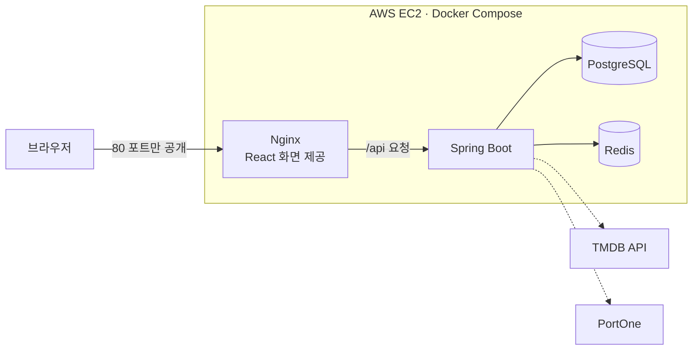
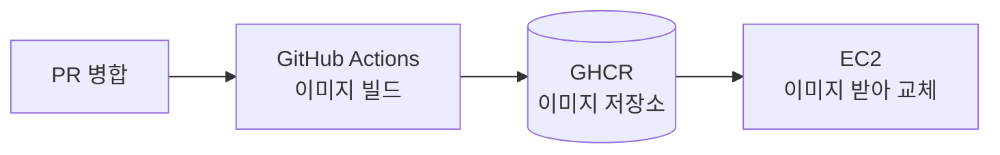

# Cineo

영화관 좌석 예약 시스템입니다. 단일 지점에 여러 상영관을 운영하는 것을 가정하고,
회원가입부터 영화 예매, 결제까지 이어지는 흐름을 백엔드부터 프론트엔드, 배포까지 직접 구현했습니다.

JWT 인증, TMDB 연동, Redis를 이용한 좌석 동시성 제어, PG 결제 검증처럼 실제 서비스에서 마주치는 문제들을 하나씩 풀어가는 걸 목표로 잡았습니다.

## 배포 주소

**http://13.239.179.10** (PC·휴대폰 모두 지원)

- 회원가입 후 바로 예매해 볼 수 있습니다.
- 결제는 포트원 **테스트 채널**(KG이니시스)로 연결되어 있습니다. 마이페이지에서 예매를 취소하면 바로 환불됩니다.
- 관리자 화면(`/admin`)은 ADMIN 권한 계정만 들어갈 수 있습니다.

## 기술 스택

| 구분 | 사용 기술 |
|---|---|
| Backend | Java 17, Spring Boot 4, Spring Security, Spring Data JPA, Bean Validation |
| DB / 캐시 | PostgreSQL, Redis |
| 인증 | JWT (access 30분 / refresh 14일) |
| 외부 API | TMDB (영화 정보), PortOne V1 (결제 검증·환불) |
| Frontend | React 19, React Router, Vite |
| 테스트 | JUnit 5, Mockito |
| 배포 | AWS EC2 (Amazon Linux 2023), Docker Compose, Nginx, GitHub Actions, GHCR |

## 주요 기능

**사용자**
- 회원가입·로그인, access token 만료 시 refresh token으로 자동 재발급
- 영화 목록(검색·정렬), 영화 상세와 날짜별 상영시간
- 좌석 선택 → 5분 선점(타이머 표시) → PortOne 결제 → 예매 확정
- 마이페이지: 등급·적립금·누적 결제, 예매 내역, 예매 취소(환불)
- 휴대폰 화면 대응: 좌석 수에 맞춰 좌석 크기 조정, 모바일 결제(결제창이 페이지 이동으로 열리는 방식) 지원

**관리자** (`/admin`, ADMIN 권한)
- TMDB 제목 검색으로 영화 등록
- 상영관 등록 (행·열 수 입력, 좌석 자동 생성, 좌석판 미리보기)
- 상영시간 등록·조회·삭제 (예매 기록이나 좌석 선점이 있으면 삭제 거절)

## 설계하면서 고민한 부분

### 1. 좌석 동시 선점 (Redis)
- 좌석을 고르면 Redis에 `seat-hold:{상영ID}:{좌석ID}` 키를 `SETNX` + TTL 5분으로 저장합니다. 먼저 저장한 사람만 성공하므로 같은 좌석을 두 명이 동시에 잡을 수 없습니다.
- 여러 좌석 중 하나라도 실패하면 이미 잡은 좌석을 직접 풀어 줍니다.
- 좌석 상태(빈 좌석 / 선점 / 예매 완료)는 DB에 저장하지 않고, 조회할 때 Redis와 예매 테이블을 보고 계산합니다.

### 2. 결제 검증과 자동 환불 (PortOne)
- 화면에서 결제가 끝나면 서버가 `imp_uid`로 PortOne에 실제 결제 내역을 다시 조회합니다. 화면이 보낸 금액은 믿지 않고, 서버가 계산한 금액과 비교합니다.
- 금액이 다르거나, 결제 사이에 좌석을 뺏겼거나, 상영이 이미 시작됐으면 **결제를 자동으로 환불**하고 예매를 거절합니다.
- 같은 `imp_uid`는 한 번만 쓸 수 있습니다 (중복 결제 방지).
- 예매 확정은 회원·상영 행에 비관적 락을 걸어서, 동시에 들어온 요청을 순서대로 처리합니다.

### 3. 가격과 적립금
- 좌석 가격 = 기본 가격 + 포맷 추가금(3D +2,000 / IMAX +6,000 / 4DX +8,000)
- 가격은 서버가 계산합니다. 좌석 화면의 가격 미리보기와 결제 금액 검증이 같은 계산을 씁니다.
- 예매할 때의 가격을 예매 좌석에 저장해 두어, 나중에 기본 가격이 바뀌어도 지난 예매 금액은 그대로입니다.
- 결제 금액의 일정 비율을 적립하고 누적 결제액으로 등급이 정해집니다 (BASIC 1% / SILVER 10만 원↑ 2% / GOLD 30만 원↑ 3% / VIP 70만 원↑ 5%). 취소하면 적립금과 누적 금액을 되돌립니다.

### 4. 권한
- `/api/admin/**`는 Security 설정의 URL 규칙(`hasRole("ADMIN")`)과 메서드마다 붙인 `@PreAuthorize`로 두 번 막습니다.
- 영화·상영시간 조회(`GET /api/movies/**`)만 로그인 없이 열려 있고, 나머지는 모두 로그인이 필요합니다.
- 프론트에서 관리자 메뉴를 숨기는 건 편의용이고, 실제로 막는 건 서버입니다.

### 5. 배포 구조



- 4개 컨테이너를 Docker Compose로 묶었습니다. 외부에는 Nginx의 80 포트만 열고, DB·Redis·백엔드는 컨테이너끼리만 통신합니다.
- Nginx가 React 빌드 파일을 보여주고, 주소가 `/api`로 시작하면 Spring Boot로 넘깁니다.
- DB 데이터는 Docker 볼륨에 저장해서 컨테이너를 새로 만들어도 남아 있습니다.

### 6. 자동 배포 (GitHub Actions)



- 메모리 1GB 서버에서 직접 빌드하면 느려서, 빌드를 GitHub Actions로 옮겼습니다. 서버는 완성된 이미지를 받아 바꿔 끼우기만 합니다.
- main에 병합되면 프론트·백엔드 이미지를 만들어 GHCR에 올리고, 이어서 서버에 접속해 새 이미지로 교체합니다. 병합부터 반영까지 약 2분 걸립니다.
- SSH는 평소에 관리자 IP만 열어 둡니다. 배포하는 동안에만 Actions의 IP를 보안 그룹에 추가하고, 끝나면(실패해도) 바로 지웁니다.
- Actions가 쓰는 AWS 키는 보안 그룹 규칙 추가·삭제만 할 수 있고, 서버 접속에는 배포 전용 SSH 키를 따로 씁니다.

## 실행 방법 (로컬)

### 준비물
- Java 17, Node.js, Docker (Redis용), PostgreSQL
- TMDB API 키, PortOne 테스트 채널 (결제를 테스트할 경우)

### 1. DB와 Redis
```bash
# PostgreSQL에 movie 데이터베이스를 만든다
createdb -U postgres movie

# Redis (외부에서 접근하지 못하게 localhost에만 연다)
docker run -d --name cineo-redis -p 127.0.0.1:6379:6379 redis
```

### 2. 백엔드 (포트 8082)
환경변수를 설정하고 `local` 프로필로 실행합니다.

| 환경변수 | 설명 |
|---|---|
| `SPRING_PROFILES_ACTIVE` | `local` (초기 데이터 생성, PortOne 테스트 결제 허용) |
| `DB_USERNAME`, `DB_PASSWORD` | PostgreSQL 계정 |
| `JWT_SECRET` | JWT 서명 키 (32바이트 이상) |
| `TMDB_API_KEY` | TMDB API 키 |
| `PORTONE_API_KEY`, `PORTONE_API_SECRET` | PortOne REST API 키 |

```bash
./gradlew bootRun
```

`local` 프로필로 처음 실행하면 TMDB에서 영화 12편을 등록하고, 상영관과 내일부터 3일치 상영시간을 자동으로 만듭니다.

### 3. 프론트엔드 (포트 5173)
```bash
cd frontend
cp .env.example .env.local   # PortOne 가맹점 식별코드와 채널 키를 채운다
npm install
npm run dev
```

### Docker Compose로 한 번에 실행 (배포와 같은 구성)
```bash
cp .env.example .env   # DB 비밀번호, JWT 키, TMDB·PortOne 키를 채운다
docker compose up -d --build
```
`http://localhost`로 접속합니다. 운영(`prod`) 프로필로 떠서 초기 데이터가 없으니, 관리자 계정으로 영화·상영관·상영시간을 등록합니다.

### 관리자 계정
회원가입을 한 뒤 DB에서 권한을 바꾸고, **다시 로그인**합니다 (권한은 로그인할 때 받는 토큰에 들어갑니다).
```sql
UPDATE member SET role = 'ADMIN' WHERE email = '가입한 이메일';
```

### 테스트
```bash
./gradlew test
```
Mockito 단위 테스트는 바로 돌아갑니다. `@SpringBootTest` 테스트는 PostgreSQL·Redis와 위 환경변수가 있어야 합니다.

## API 요약

| 메서드 | 경로 | 설명 | 권한 |
|---|---|---|---|
| POST | `/api/auth/signup` | 회원가입 | - |
| POST | `/api/auth/login` | 로그인 (access/refresh 발급) | - |
| POST | `/api/auth/refresh` | access token 재발급 | - |
| POST | `/api/auth/logout` | 로그아웃 | 로그인 |
| GET | `/api/members/me` | 내 정보 (등급, 적립금, 권한) | 로그인 |
| GET | `/api/movies` | 영화 목록 | - |
| GET | `/api/movies/{id}` | 영화 상세 | - |
| GET | `/api/movies/{id}/showtimes` | 앞으로의 상영시간 | - |
| GET | `/api/showtimes/{id}/seats` | 좌석 현황 | 로그인 |
| POST | `/api/showtimes/{id}/seats/hold` | 좌석 선점 | 로그인 |
| DELETE | `/api/showtimes/{id}/seats/hold` | 선점 해제 | 로그인 |
| GET | `/api/showtimes/{id}/seats/price` | 선택 좌석 가격 미리보기 | 로그인 |
| POST | `/api/reservations` | 결제 검증 후 예매 확정 | 로그인 |
| GET | `/api/reservations/me` | 내 예매 목록 | 로그인 |
| GET | `/api/reservations/{id}` | 예매 상세 | 로그인 |
| DELETE | `/api/reservations/{id}` | 예매 취소 (환불) | 로그인 |
| GET, POST | `/api/admin/movies` | 영화 조회·등록 (TMDB ID) | ADMIN |
| GET | `/api/admin/movies/search?query=` | TMDB 제목 검색 | ADMIN |
| GET, POST | `/api/admin/screens` | 상영관 조회·등록 | ADMIN |
| GET, POST | `/api/admin/showtimes` | 상영시간 조회·등록 | ADMIN |
| DELETE | `/api/admin/showtimes/{id}` | 상영시간 삭제 | ADMIN |

## 앞으로 할 일

- [x] Docker Compose + AWS EC2 배포
- [x] GitHub Actions 자동 배포
- [ ] 성능 측정·개선 (부하 테스트, 좌석 조회 쿼리·인덱스 최적화)
- [ ] 도메인 연결, HTTPS 적용
- [ ] CI에서 테스트 실행 (테스트가 실패하면 배포 중단)
- [ ] 같은 상영관에 시간이 겹치는 상영 등록 막기
- [ ] 로그인·좌석 선점 요청 횟수 제한
- [ ] MyBatis로 매출·예매 현황 같은 조건이 많은 조회 추가
